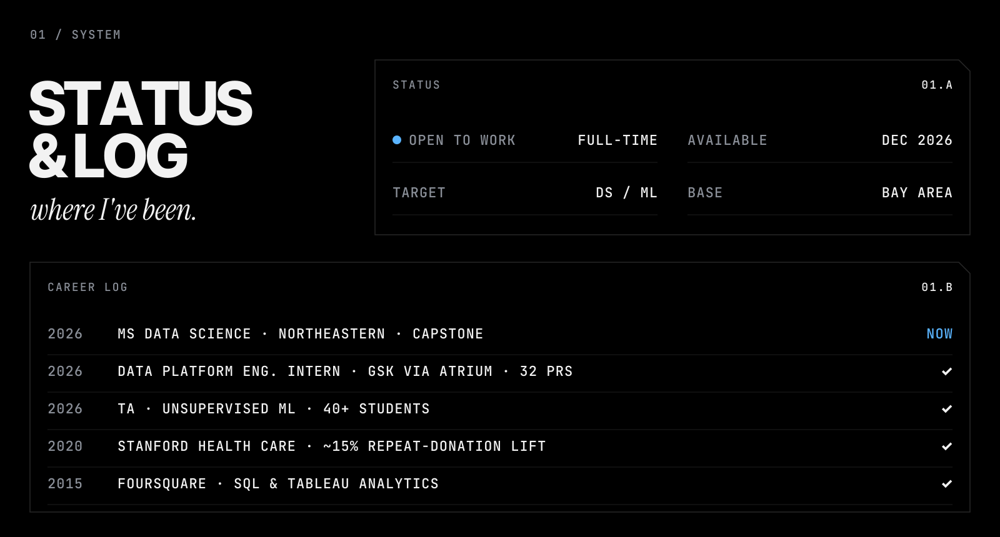
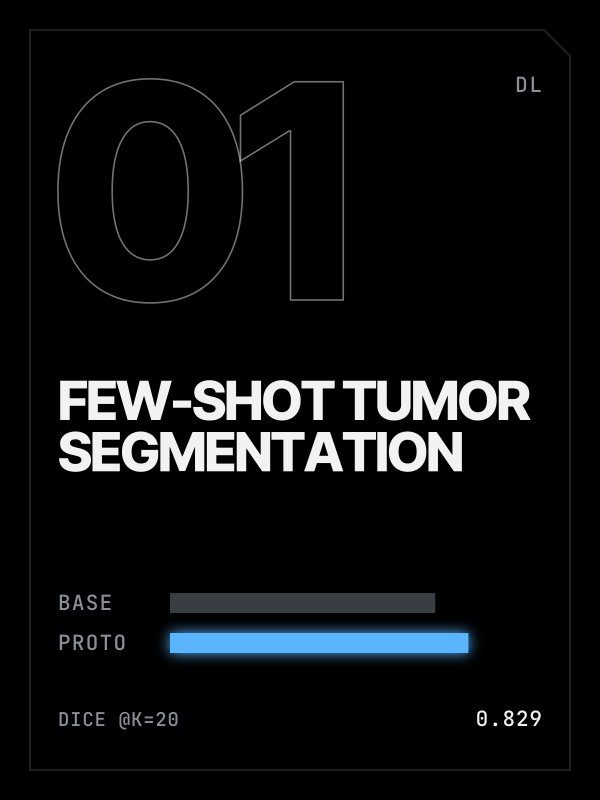
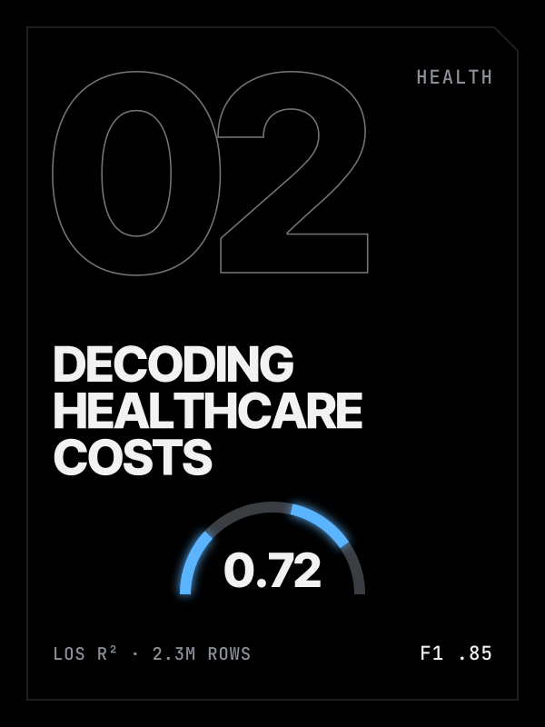
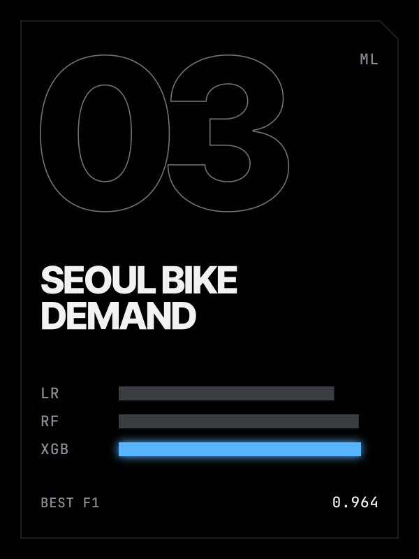
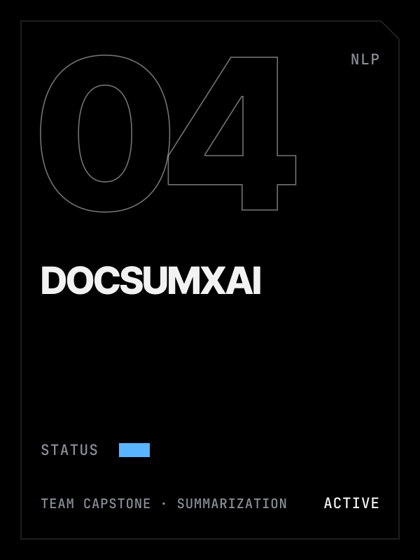
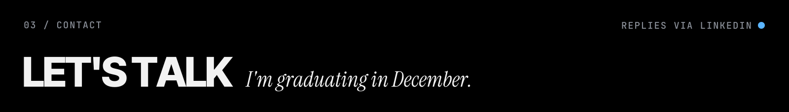
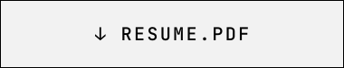

## About

I'm a **Data Scientist** finishing an MS in Data Science at Northeastern University (Khoury College), graduating **Dec 2026**, and open to full-time data science and ML roles in the Bay Area.

Before grad school I spent four and a half years at Stanford Health Care's Blood Center, where I ran a self-initiated donor-retention project that lifted the repeat-donation rate by about 15%. Before that, I analyzed app engagement with SQL and Tableau at Foursquare. In 2026 I interned on GSK's Omics Workbench (via Atrium), building pipeline automation for Nextflow workflows on Google Cloud Batch.

**Selected projects**
- [Few-shot brain tumor segmentation](https://github.com/sherwinvahidi/UNet-FewShot) (team project): prototypical network reaches 0.829 Dice at k=20, above the 0.737 fully supervised baseline
- [Decoding healthcare costs](https://github.com/sherwinvahidi/Decoding-Healthcare-Costs): 2.3M NYC hospital records; length-of-stay R² 0.72, mortality F1 0.85
- [Seoul bike demand](https://github.com/sherwinvahidi/DS-5110-Final-Project-Seoul-Bike-Sharing) (team project): XGBoost F1 0.964 with temporal cross-validation
- DocSumXAI (team capstone, in progress): explainable long-document summarization

**Skills:** Python · SQL · PyTorch · pandas · NumPy · scikit-learn · GCP (Batch) · Nextflow · Tableau · Jupyter

**Resume:** [PDF](https://github.com/sherwinvahidi/sherwinvahidi/raw/main/resume/Sherwin_Vahidimowlavi_Resume.pdf) &nbsp;·&nbsp; **LinkedIn:** [linkedin.com/in/sherwinvahidi](https://www.linkedin.com/in/sherwinvahidi)
